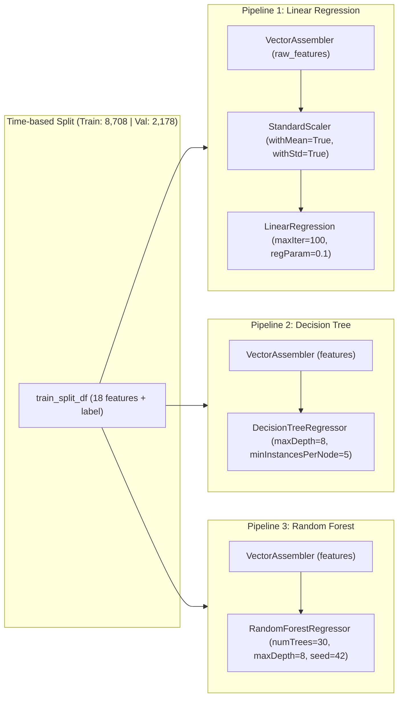

# BÁO CÁO KỸ THUẬT MILESTONE 5: MACHINE LEARNING VỚI APACHE SPARK MLlib

**Dự án:** Large-Scale Bike Sharing Demand Analysis and Forecasting using Apache Spark  
**Tên tiếng Việt:** Phân tích dữ liệu quy mô lớn và dự đoán nhu cầu sử dụng xe đạp chia sẻ bằng Apache Spark  
**Ngày thực hiện:** 2026-11-11  
**Trạng thái:** Hoàn thành 100% (Giai đoạn A $\rightarrow$ G)

---

## 1. Mục tiêu bài toán

Milestone 5 tập trung xây dựng, huấn luyện, đánh giá khách quan và lưu trữ các mô hình Học máy phân tán (Distributed Machine Learning) bằng thư viện **Apache Spark MLlib** (`pyspark.ml`) nhằm dự đoán nhu cầu thuê xe đạp theo từng giờ:
- **Loại bài toán:** Hồi quy (Supervised Regression).
- **Biến mục tiêu (Target / Label):** `count` — tổng số lượt thuê xe đạp trong khung giờ tương ứng (`count >= 0`).
- **Ba mô hình thực nghiệm:**
  1. `Linear Regression` (Hồi quy tuyến tính có chuẩn hóa đặc trưng `StandardScaler` và điều chuẩn L2 Ridge).
  2. `Decision Tree Regressor` (Cây quyết định hồi quy phi tuyến).
  3. `Random Forest Regressor` (Rừng ngẫu nhiên kết hợp nhiều cây quyết định độc lập).
- **Đối chuẩn cơ sở (Baseline):** `Mean Predictor` (dự đoán mọi bản ghi Validation bằng giá trị trung bình `count` của tập Training = `174.3912`).

---

## 2. Dữ liệu và Feature sử dụng

Dữ liệu đầu vào được đọc trực tiếp từ bộ **Model Feature Dataset** (định dạng Parquet nén Snappy) trên HDFS đã hoàn thiện tại Milestone 4:
- **Train features:** `/bike-sharing/features/train/` (`10,886` dòng, `20` cột: `datetime`, 18 cột đặc trưng đầu vào và cột nhãn `count`).
- **Test features:** `/bike-sharing/features/test/` (`6,493` dòng, `19` cột: `datetime` và 18 cột đặc trưng đầu vào, không có `count`).

### Danh sách 18 đặc trưng đầu vào (`FEATURE_COLS`)
| Nhóm đặc trưng | Các cột thành phần | Số lượng | Ý nghĩa kỹ thuật |
| :--- | :--- | :---: | :--- |
| **Thời tiết & Lịch biểu gốc** | `season`, `holiday`, `workingday`, `weather`, `temp`, `atemp`, `humidity`, `windspeed` | 8 | Phản ánh điều kiện khí tượng và phân loại ngày làm việc/nghỉ lễ. |
| **Thời gian trích xuất** | `year`, `month`, `day`, `hour`, `dayofweek`, `is_weekend` | 6 | Nắm bắt xu hướng tăng trưởng theo năm (`2011` $\rightarrow$ `2012`) và quy luật sinh hoạt theo giờ/thứ. |
| **Đặc trưng chu kỳ (Cyclical)** | `hour_sin`, `hour_cos`, `month_sin`, `month_cos` | 4 | Biểu diễn tính tuần hoàn liên tục của giờ ($23\text{h} \rightarrow 0\text{h}$) và tháng ($12 \rightarrow 1$), hỗ trợ đặc biệt cho mô hình tuyến tính. |

### Kiểm soát rò rỉ dữ liệu (Data Leakage Prevention)
1. **Loại bỏ tuyệt đối `casual` và `registered`:** Do `casual + registered = count` trên toàn bộ tập dữ liệu và hai cột này không xuất hiện trong `test.csv`, cả hai đã bị loại bỏ hoàn toàn khỏi tập đặc trưng.
2. **Loại bỏ cột định danh thời gian và nhãn khỏi `VectorAssembler`:** Cột `datetime` (dùng để sắp xếp thời gian và xuất kết quả) và cột `count` (biến mục tiêu) không được đưa vào `inputCols` của `VectorAssembler`.
3. **Cô lập hoàn toàn tập Test:** Tập `/bike-sharing/features/test/` chỉ được sử dụng đúng một lần ở Giai đoạn F để sinh dự đoán cuối cùng.

---

## 3. Phương pháp chia Train / Validation (Time-based Split)

Vì dữ liệu nhu cầu thuê xe đạp là chuỗi thời gian theo giờ có xu hướng tăng trưởng rõ rệt từ năm 2011 sang năm 2012, việc chia ngẫu nhiên (`randomSplit`) sẽ làm rò rỉ thông tin tương lai vào quá khứ. Do đó, kịch bản [train_models.py](file:///c:/Users/BOOK%20PRO/distributed_sys_docker_setup/compute/spark/jobs/train_models.py) áp dụng phương pháp **Time-based Split (80% / 20%)**:

1. Sắp xếp toàn bộ `10,886` bản ghi của `/bike-sharing/features/train/` theo `datetime` tăng dần (`Window.orderBy(F.col("datetime").asc())`).
2. **Tập Training (80% đầu):**
   - **Số dòng:** `8,708` bản ghi.
   - **Khoảng thời gian:** Từ `2011-01-01 00:00:00` đến `2012-08-05 04:00:00`.
3. **Tập Validation (20% cuối):**
   - **Số dòng:** `2,178` bản ghi.
   - **Khoảng thời gian:** Từ `2012-08-05 05:00:00` đến `2012-12-19 23:00:00`.
4. **Kiểm chứng ranh giới thời gian:**
   - $\max(\text{Training.datetime}) = \text{2012-08-05 04:00:00} < \min(\text{Validation.datetime}) = \text{2012-08-05 05:00:00}$.
   - Không có bất kỳ bản ghi Validation nào nằm trước hoặc trùng thời điểm với tập Training.

---

## 4. Kiến trúc Pipeline MLlib

Mỗi mô hình được đóng gói trong một đối tượng `pyspark.ml.Pipeline` độc lập và được huấn luyện tuần tự (`.fit(train_split_df)`) để tránh tranh chấp bộ nhớ trên cụm 1 Spark Worker (`2 cores`, `2 GB RAM`, `spark.executor.memory=1g`):



- Đối với `Linear Regression`, bước `StandardScaler(withMean=True, withStd=True)` được khớp (`.fit()`) **chỉ trên tập Training** bên trong Pipeline để chuẩn hóa các biến có thang đo khác nhau (`year` $\approx 2011\text{–}2012$, `humidity` $\approx 0\text{–}100$, `hour_sin` $\in [-1, 1]$) mà không gây rò rỉ thống kê từ tập Validation/Test.
- Đối với `Decision Tree` và `Random Forest`, thuật toán phân hoạch theo ngưỡng thứ tự nên sử dụng trực tiếp vector đặc trưng từ `VectorAssembler`.

---

## 5. Cấu hình ba mô hình

| Mô hình | Các stage trong Pipeline | Siêu tham số (Hyperparameters) | Lý do cấu hình |
| :--- | :--- | :--- | :--- |
| **Linear Regression** | `VectorAssembler` $\rightarrow$ `StandardScaler` $\rightarrow$ `LinearRegression` | `maxIter=100`, `regParam=0.1`, `elasticNetParam=0.0` (L2 Ridge) | Điều chuẩn L2 (`regParam=0.1`) giúp ổn định trọng số khi hai biến `temp` và `atemp` có tương quan tuyến tính cao ($r = 0.9849$). |
| **Decision Tree Regressor** | `VectorAssembler` $\rightarrow$ `DecisionTreeRegressor` | `maxDepth=8`, `minInstancesPerNode=5`, `seed=42` | Độ sâu `maxDepth=8` đủ nắm bắt tương tác phi tuyến bậc cao (`hour` $\times$ `workingday` $\times$ `temp` $\times$ `year`), trong khi `minInstancesPerNode=5` hạn chế overfitting tại các nút lá. |
| **Random Forest Regressor** | `VectorAssembler` $\rightarrow$ `RandomForestRegressor` | `numTrees=30`, `maxDepth=8`, `minInstancesPerNode=5`, `subsamplingRate=0.8`, `featureSubsetStrategy="auto"`, `seed=42` | Tổ hợp 30 cây độc lập giúp giảm phương sai (variance) so với cây đơn lẻ mà vẫn giữ dung lượng task binary truyền qua mạng ở mức an toàn (~1.2 MB) trên Worker 1 GB RAM. |

---

## 6. Kết quả đánh giá RMSE, MAE, R2 (và RMSLE)

Bảng dưới đây tổng hợp kết quả thực nghiệm thực tế trên tập **Validation (`2,178` dòng, từ `2012-08-05 05:00:00` đến `2012-12-19 23:00:00`)**, được trích xuất từ [model_comparison_metrics.csv](file:///c:/Users/BOOK%20PRO/distributed_sys_docker_setup/outputs/models/model_comparison_metrics.csv) và [best_model_metadata.json](file:///c:/Users/BOOK%20PRO/distributed_sys_docker_setup/outputs/models/best_model_metadata.json):

| Mô hình | RMSE (raw) $\downarrow$ | MAE (raw) $\downarrow$ | $R^2$ (raw) $\uparrow$ | RMSE (clipped) $\downarrow$ | RMSLE (clipped) $\downarrow$ | Số dự đoán âm (`< 0`) | Thời gian huấn luyện (s) |
| :--- | :---: | :---: | :---: | :---: | :---: | :---: | :---: |
| *Baseline (Mean Predictor = 174.39)* | *233.9322* | *176.5815* | *-0.1558* | *233.9322* | *—* | *0* | *—* |
| **1. Linear Regression** | 164.4157 | 121.8134 | 0.4291 | 164.4157 | 1.0940 | 0 / 2,178 | **10.5608 s** |
| **2. Decision Tree Regressor** | 100.7967 | **65.1976** | 0.7854 | 100.7967 | 0.4382 | 0 / 2,178 | 18.7804 s |
| **3. Random Forest Regressor** | **99.1848** | 66.3189 | **0.7922** | **99.1848** | **0.4016** | 0 / 2,178 | 34.3088 s |

> [!NOTE]
> - Trên tập Validation (nằm ở nửa cuối năm 2012), cả 3 mô hình đều không sinh ra giá trị dự đoán âm (`negative_predictions_count = 0`), do đó `RMSE (raw)` và `RMSE (clipped)` hoàn toàn bằng nhau. Tuy nhiên, bước hậu xử lý `prediction_clipped = greatest(prediction, 0.0)` vẫn được giữ cố định trong quy trình để đảm bảo an toàn toán học tuyệt đối khi tính `RMSLE` ($\log(1 + \hat{y})$) và khi áp dụng cho dữ liệu mới.
> - `Mean Predictor` có $R^2 = -0.1558 < 0$ trên tập Validation vì trung bình lượt thuê của giai đoạn Training (`174.39` lượt/giờ, bao gồm cả năm 2011 và nửa đầu 2012) thấp hơn đáng kể so với trung bình thực tế của giai đoạn Validation cuối năm 2012 (`254.57` lượt/giờ). Điều này chứng minh tính chất non-stationary (dịch chuyển phân phối theo thời gian) của bài toán Time-based Split.

---

## 7. Thời gian huấn luyện

Quá trình huấn luyện được thực hiện tuần tự trên cụm Spark Standalone (`1 Master` + `1 Worker` với `2 CPU cores` và `1024 MiB Executor RAM`):
- **Linear Regression:** `10.5608 giây` — Nhanh nhất nhờ bài toán tối ưu lồi L2 Ridge hội tụ nhanh trên không gian 18 chiều đã chuẩn hóa.
- **Decision Tree Regressor:** `18.7804 giây` — Thời gian tăng vừa phải do Spark thực hiện quét tìm điểm chia tối ưu (binning & splitting) tới độ sâu `maxDepth=8`.
- **Random Forest Regressor:** `34.3088 giây` — Lâu nhất (gấp ~3.25 lần Linear Regression và ~1.83 lần Decision Tree) do phải xây dựng song song 30 cây quyết định độ sâu 8 và truyền cấu trúc cây (`1,219.0 KiB` task binary) giữa Driver và Executor.

---

## 8. So sánh, phân tích Feature Importance và lựa chọn mô hình

### 8.1. Phân tích hiệu năng giữa các mô hình
1. **Tại sao Linear Regression có sai số cao nhất (`RMSE = 164.4157`, $R^2 = 0.4291$)?**
   - Mặc dù đã bổ sung các đặc trưng chu kỳ (`hour_sin`, `hour_cos`, `month_sin`, `month_cos`), mô hình tuyến tính chỉ biểu diễn được hàm cộng tính đơn điệu, không thể tự nắm bắt được hình dạng **hai đỉnh (bimodal)** vào giờ cao điểm sáng (`08:00`) và chiều (`17:00–18:00`), cũng như **sự đảo chiều hành vi** giữa ngày đi làm (`workingday = 1`) và ngày nghỉ (`workingday = 0` có đỉnh vào `12:00–16:00`).
2. **Bước nhảy vọt của các mô hình cây (`Decision Tree` & `Random Forest`):**
   - `Decision Tree Regressor` giảm mạnh RMSE từ `164.4157` xuống `100.7967` (giảm **38.69%** sai số RMSE) và nâng $R^2$ từ `0.4291` lên `0.7854`.
   - `Random Forest Regressor` đạt kết quả tốt nhất trên các thước đo quan trọng nhất: **RMSE thấp nhất (`99.1848`)**, **$R^2$ cao nhất (`0.7922`)** và **RMSLE thấp nhất (`0.4016`)**. Mặc dù `Decision Tree` có MAE thấp hơn một chút (`65.1976` so với `66.3189`), `Random Forest` kiểm soát tốt hơn các sai số cực단 (outliers) vào giờ cao điểm nhờ lấy trung bình 30 cây, giúp giảm cả RMSE lẫn RMSLE.

### 8.2. Mức độ quan trọng của đặc trưng (Top 10 Feature Importances)
Trích xuất từ [feature_importances.csv](file:///c:/Users/BOOK%20PRO/distributed_sys_docker_setup/outputs/models/feature_importances.csv):

| Hạng | Đặc trưng (`feature`) | Random Forest Importance | Decision Tree Importance | Nhận xét chuyên môn |
| :---: | :--- | :---: | :---: | :--- |
| 1 | `hour` | **0.304528** (30.45%) | **0.497250** (49.73%) | Yếu tố quyết định số 1 chi phối nhu cầu thuê xe theo khung giờ trong ngày. |
| 2 | `hour_sin` | **0.180155** (18.02%) | 0.131400 (13.14%) | Kết hợp cùng `hour` và `hour_cos` giúp rừng cây phân tách mượt các vùng chuyển tiếp sáng/tối. |
| 3 | `hour_cos` | **0.111465** (11.15%) | 0.027149 (2.71%) | Bổ trợ phân biệt nửa ngày đầu/cuối và đêm khuya. |
| 4 | `atemp` | **0.089580** (8.96%) | 0.003427 (0.34%) | Random Forest tận dụng cả `atemp` (8.96%) và `temp` (7.35%) nhờ cơ chế lấy mẫu đặc trưng ngẫu nhiên (`featureSubsetStrategy="auto"`), trong khi Decision Tree đơn lẻ dồn gần hết trọng số vào `temp` (15.39%). |
| 5 | `year` | **0.077030** (7.70%) | 0.079265 (7.93%) | Nắm bắt mức tăng trưởng ~65.4% từ năm 2011 sang năm 2012. |
| 6 | `temp` | **0.073504** (7.35%) | 0.153920 (15.39%) | Nhiệt độ thực tế ảnh hưởng trực tiếp đến quyết định đi xe ngoài trời. |
| 7 | `workingday` | **0.033424** (3.34%) | 0.048186 (4.82%) | Tách biệt mẫu hình đi làm (2 đỉnh 8h & 17h) và nghỉ ngơi (1 đỉnh trưa–chiều). |
| 8 | `humidity` | **0.025871** (2.59%) | 0.014425 (1.44%) | Độ ẩm cao (mưa/nồm) làm giảm nhu cầu thuê xe. |
| 9 | `is_weekend` | **0.025837** (2.58%) | 0.012696 (1.27%) | Bổ sung thông tin ngày cuối tuần cùng với `workingday`. |
| 10 | `season` | **0.020434** (2.04%) | 0.001172 (0.12%) | Phản ánh sự khác biệt theo mùa (Mùa Thu cao nhất, Mùa Xuân thấp nhất). |

### 8.3. Quyết định lựa chọn Best Model
Dựa trên tiêu chí **Validation RMSE thấp nhất (`99.1848`)**, **$R^2$ cao nhất (`0.7922`)** và **RMSLE thấp nhất (`0.4016`)**, mô hình **`Random Forest Regressor`** chính thức được chọn làm **Best Model** để lưu vào `/bike-sharing/models/best_model/` và thực hiện dự đoán trên tập Test.

---

## 9. Kết quả dự đoán trên tập Test

Sử dụng `Random Forest Regressor` (`best_model`), hệ thống đã thực hiện dự đoán trên toàn bộ `6,493` bản ghi của `/bike-sharing/features/test/` (từ ngày `20` đến cuối tháng của mỗi tháng trong hai năm 2011–2012):
- **Tổng số dòng dự đoán:** `6,493` dòng (khớp 100% với `test.csv` và `sampleSubmission.csv`).
- **Số lượng dự đoán âm trước khi clip:** `0` dòng.
- **10 dòng dự đoán đầu tiên trên tập Test (`2011-01-20 00:00:00` $\rightarrow$ `09:00:00`):**

| `datetime` | `prediction` (Float) | `prediction_clipped` (Float) | `count` (Kaggle Submission Integer) |
| :--- | :---: | :---: | :---: |
| `2011-01-20 00:00:00` | 15.0707 | 15.0707 | 15 |
| `2011-01-20 01:00:00` | 7.4946 | 7.4946 | 7 |
| `2011-01-20 02:00:00` | 4.8612 | 4.8612 | 5 |
| `2011-01-20 03:00:00` | 4.0780 | 4.0780 | 4 |
| `2011-01-20 04:00:00` | 4.0784 | 4.0784 | 4 |
| `2011-01-20 05:00:00` | 11.6364 | 11.6364 | 12 |
| `2011-01-20 06:00:00` | 43.4334 | 43.4334 | 43 |
| `2011-01-20 07:00:00` | 111.7256 | 111.7256 | 112 |
| `2011-01-20 08:00:00` | 127.5813 | 127.5813 | 128 |
| `2011-01-20 09:00:00` | 105.6924 | 105.6924 | 106 |

Quy luật dự đoán ngày `2011-01-20` (Thứ Năm - ngày làm việc mùa Xuân năm 2011) phản ánh chính xác hành vi thực tế: nhu cầu giảm sâu về đêm (`4–5` xe lúc `02:00–04:00`), tăng vọt vào giờ đi làm buổi sáng (`112` xe lúc `07:00`, đạt đỉnh `128` xe lúc `08:00`), giảm nhẹ lúc `09:00–15:00` và đạt đỉnh cao điểm chiều lúc `17:00` (`172` xe).

---

## 10. Đường dẫn lưu Model trên HDFS

Toàn bộ PipelineModel và metadata đã được lưu trữ bền vững trên HDFS (`hdfs://hadoop-namenode:9000`):
1. **Linear Regression PipelineModel:** `/bike-sharing/models/linear_regression`
2. **Decision Tree PipelineModel:** `/bike-sharing/models/decision_tree`
3. **Random Forest PipelineModel:** `/bike-sharing/models/random_forest`
4. **Best Model (`Random Forest Regressor`):**
   - PipelineModel: `/bike-sharing/models/best_model/pipeline_model`
   - Metadata JSON: `/bike-sharing/models/best_model/metadata`

---

## 11. Đường dẫn Predictions và Kaggle Submission

### Trên HDFS (`hdfs://hadoop-namenode:9000`)
- **Test Predictions (Parquet nén Snappy, gồm `datetime, prediction, prediction_clipped`):**  
  `/bike-sharing/predictions/test_predictions_parquet`
- **Kaggle Submission (CSV, gồm `datetime, count`):**  
  `/bike-sharing/predictions/kaggle_submission_csv`

### Trên máy Host (Local Workspace)
- [model_comparison_metrics.csv](file:///c:/Users/BOOK%20PRO/distributed_sys_docker_setup/outputs/models/model_comparison_metrics.csv) — Bảng tổng hợp các chỉ số RMSE, MAE, R2, RMSLE và thời gian huấn luyện của 3 mô hình.
- [best_model_metadata.json](file:///c:/Users/BOOK%20PRO/distributed_sys_docker_setup/outputs/models/best_model_metadata.json) — Metadata đầy đủ của mô hình tốt nhất, cấu hình Time-based split, danh sách 18 features và bảng xếp hạng Feature Importance.
- [feature_importances.csv](file:///c:/Users/BOOK%20PRO/distributed_sys_docker_setup/outputs/models/feature_importances.csv) — Trọng số quan trọng của 18 đặc trưng từ Random Forest và Decision Tree.
- [validation_predictions.csv](file:///c:/Users/BOOK%20PRO/distributed_sys_docker_setup/outputs/models/validation_predictions.csv) — `2,178` dòng dự đoán trên tập Validation của cả 3 mô hình kèm `actual_count`.
- [test_predictions.csv](file:///c:/Users/BOOK%20PRO/distributed_sys_docker_setup/outputs/models/test_predictions.csv) (và bản sao tại [outputs/predictions/test_predictions.csv](file:///c:/Users/BOOK%20PRO/distributed_sys_docker_setup/outputs/predictions/test_predictions.csv)) — `6,493` dòng dự đoán chi tiết trên tập Test.
- [kaggle_submission.csv](file:///c:/Users/BOOK%20PRO/distributed_sys_docker_setup/outputs/models/kaggle_submission.csv) (và bản sao tại [outputs/predictions/kaggle_submission.csv](file:///c:/Users/BOOK%20PRO/distributed_sys_docker_setup/outputs/predictions/kaggle_submission.csv)) — Tệp chuẩn Kaggle Submission (`1` dòng header `datetime,count` + `6,493` dòng dữ liệu = `6,494` dòng).

---

## 12. Các lỗi phát sinh và cách khắc phục

### Lỗi: `ModuleNotFoundError: No module named 'numpy'` khi import `pyspark.ml`
- **Hiện tượng:** Ở lần chạy `spark-submit` đầu tiên, tiến trình báo lỗi `ModuleNotFoundError: No module named 'numpy'` tại dòng `from pyspark.ml import Pipeline`.
- **Nguyên nhân:** Image `bitnamilegacy/spark:3.5` chỉ cài sẵn gói cơ bản `pyspark==3.5.6` trong môi trường Python 3.12 mà chưa cài đặt thư viện `numpy` — vốn là phụ thuộc bắt buộc của mô-đun `pyspark.ml.linalg` và `pyspark.ml.param`.
- **Cách khắc phục:** Cài đặt trực tiếp gói `numpy<2` (`numpy-1.26.4`, tương thích hoàn toàn với PySpark 3.5.6) kèm cờ `--no-cache-dir` vào cả 2 container đang chạy (`spark-master` và `spark-worker-1`):
  ```powershell
  docker exec -u 0 spark-master python3 -m pip install --no-cache-dir "numpy<2"
  docker exec -u 0 spark-worker-1 python3 -m pip install --no-cache-dir "numpy<2"
  ```
  Giải pháp này chỉ tốn ~18 MB băng thông tải wheel, không lưu cache thừa trên ổ C và tuân thủ tuyệt đối ràng buộc không pull hay build Docker image mới.

---

## 13. Hạn chế của thí nghiệm và hướng cải tiến

1. **Hạn chế về hiệu ứng dịch chuyển quy mô theo thời gian (Trend Extrapolation của Tree Models):**
   - Các mô hình dựa trên cây quyết định (`Decision Tree`, `Random Forest`) dự đoán bằng giá trị trung bình của các mẫu Training rơi vào nút lá, nên không thể tự ngoại suy vượt quá ngưỡng cực đại đã từng thấy trong tập Training. Khi chia Time-based Split (80% đầu làm Train, 20% cuối vào mùa Thu–Đông 2012 làm Validation), nhu cầu thuê xe cuối năm 2012 có những khung giờ cao hơn mặt bằng trung bình đầu năm 2011–giữa 2012.
2. **Hướng cải tiến:**
   - **Biến đổi mục tiêu theo hàm Log (`log1p(count)`):** Huấn luyện mô hình dự đoán $z = \ln(1 + \text{count})$ và lấy $\hat{y} = \max(0, \exp(\hat{z}) - 1)$ khi suy diễn. Cách này giúp tối ưu trực tiếp thước đo RMSLE và giảm độ lệch phải (right-skewness = `1.2417`) của biến mục tiêu.
   - **Đặc trưng tương tác (Interaction Features):** Bổ sung đặc trưng kết hợp giữa `hour` và `workingday` (ví dụ `hour_workingday = hour * workingday`) hoặc thử nghiệm `GBTRegressor` (Gradient-Boosted Trees) với số vòng lặp nhỏ (`maxIter=30`, `maxDepth=5`).
   - **Mở rộng quy mô dữ liệu lớn (Milestone 6):** Tiến hành sinh dữ liệu mở rộng có kiểm soát (Synthetic Scaling Benchmark) trên HDFS để đo lường tốc độ xử lý phân tán và khả năng mở rộng của Spark SQL / Spark MLlib khi kích thước dữ liệu tăng gấp nhiều lần.

