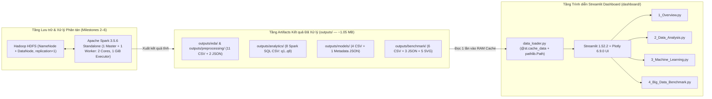

# THIẾT KẾ KIẾN TRÚC VÀ GIAO DIỆN DASHBOARD (MILESTONE 7 — PHASE B: DASHBOARD ARCHITECTURE & UI DESIGN)

**Dự án:** Large-Scale Bike Sharing Demand Analysis and Forecasting using Apache Spark  
**Tên ứng dụng:** Bike Sharing Demand Analysis & Forecasting Dashboard  
**Repository:** `C:\Users\BOOK PRO\distributed_sys_docker_setup`  
**Ngày thực hiện:** 2026-11-12  
**Trạng thái:** Hoàn thành Thiết kế Kiến trúc & Giao diện (Phase B) — Chờ xác nhận triển khai Phase C

---

## 1. Kiến trúc Tổng thể Dashboard

Ứng dụng **Bike Sharing Demand Analysis & Forecasting Dashboard** được thiết kế theo kiến trúc **Decoupled Read-Only Analytical Presentation Layer** (Tầng trình diễn phân tích tách rời, chỉ đọc dữ liệu đã tính toán trước):



### Nguyên tắc kiến trúc cốt lõi
1. **Không khởi tạo `SparkSession` từ Dashboard & Không truy vấn HDFS trực tiếp:** Giúp tách biệt hoàn toàn tải giao diện người dùng khỏi cụm container Docker WSL2 đang chạy `Hadoop`, `Spark` và `Langfuse`, giữ mức tiêu thụ RAM của tiến trình Streamlit dưới `~100 MB`.
2. **Định vị đường dẫn tuyệt đối an toàn (`pathlib.Path(__file__).resolve()`):** Mọi tệp dữ liệu trong `outputs/` và tài liệu trong `docs/` được truy cập qua hằng số `PROJECT_ROOT = Path(__file__).resolve().parents[1]` định nghĩa tại `dashboard/config.py`, đảm bảo ứng dụng chạy ổn định dù khởi chạy lệnh `streamlit run` từ bất kỳ thư mục làm việc nào.
3. **100% Số liệu Thực nghiệm (`Zero Fabricated Data`):** Mọi KPI card, bảng số liệu và biểu đồ tương tác chỉ hiển thị dữ liệu thực tế đã được kiểm chứng từ các Milestone 2–6.

---

## 2. Cấu trúc Thư mục Dashboard

Cấu trúc thư mục chuẩn hóa đặt tại `dashboard/` ngay dưới thư mục gốc của repository:

```text
C:\Users\BOOK PRO\distributed_sys_docker_setup\
├── dashboard/
│   ├── app.py                        # Điểm vào chính (Entrypoint): Cấu hình st.set_page_config, nạp CSS & điều hướng
│   ├── config.py                     # Định nghĩa PROJECT_ROOT, OUTPUTS_DIR, bảng màu (Color Palette), nhãn & hằng số
│   ├── data_loader.py                # Các hàm đọc CSV/JSON/SVG có gắn @st.cache_data và kiểm tra toàn vẹn dữ liệu
│   ├── pages/
│   │   ├── 1_Overview.py             # Trang 1: Tổng quan dự án, kiến trúc Hadoop+Spark, tiến trình M2–M6 & KPI tổng thể
│   │   ├── 2_Data_Analysis.py        # Trang 2: Trực quan hóa EDA, chất lượng dữ liệu & 8 truy vấn Spark SQL (q1–q8)
│   │   ├── 3_Machine_Learning.py     # Trang 3: Đánh giá 3 mô hình MLlib, Feature Importance, Validation & Test Forecast
│   │   └── 4_Big_Data_Benchmark.py   # Trang 4: Benchmark quy mô 1x–100x, CSV vs Parquet, 5 phép xử lý & Partition Tuning
│   ├── components/
│   │   ├── sidebar.py                # Thanh điều hướng bên trái, thông tin cụm hạ tầng & bộ lọc ngữ cảnh
│   │   ├── kpi_cards.py              # Thành phần hiển thị thẻ chỉ số KPI (Metric Cards) và hộp cảnh báo kỹ thuật
│   │   └── charts.py                 # Các hàm dựng biểu đồ Plotly đồng nhất theme, font chữ, đơn vị và hover tooltip
│   └── assets/
│       └── style.css                 # CSS tùy chỉnh giao diện hiện đại (thẻ KPI, badge trạng thái, bảng biểu, header)
├── outputs/                          # Dữ liệu nguồn Read-Only từ Milestone 4, 5, 6
└── docs/                             # Tài liệu báo cáo kỹ thuật Milestone 1–7
```

---

## 3. Thiết kế Chi tiết Chức năng 4 Trang Dashboard

### 3.1. Trang 1: `Overview` (`dashboard/pages/1_Overview.py`)
- **Mục tiêu:** Cung cấp cái nhìn tổng thể cấp điều hành (Executive Summary) về bài toán, tập dữ liệu, kiến trúc hệ thống Big Data và các cột mốc kết quả đạt được.
- **Các thành phần hiển thị:**
  1. **Project Header Banner:** Tên đề tài tiếng Anh & tiếng Việt, mô tả mục tiêu phân tích quy mô lớn và dự báo nhu cầu thuê xe đạp theo giờ bằng Apache Spark.
  2. **Hàng thẻ KPI Tổng quan (6 KPI Cards):**
     - **Tổng bản ghi gốc:** `17,379` dòng (`Train: 10,886` dòng $\times$ `12` cột | `Test: 6,493` dòng $\times$ `9` cột).
     - **Tổng lượt thuê xe (Train):** `2,085,476` lượt (`2011–2012`), trung bình `191.57` lượt/giờ.
     - **Mô hình dự báo tốt nhất:** `Random Forest Regressor` (`30 trees, maxDepth=8`).
     - **Độ chính xác Validation (Best Model):** `RMSE = 99.1848` | $R^2 = 0.7922$ | `RMSLE = 0.4016`.
     - **Hiệu quả nén Parquet vs CSV (100x):** Giảm **`74.89%`** dung lượng (`27.73 MB` so với `110.40 MB`, tỉ lệ nén **`3.98x`**).
     - **Đỉnh thông lượng xử lý Spark:** **`1,415,973 rows/s`** (`GroupBy` ở quy mô `50x` = `544,300` dòng).
  3. **Kiến trúc Hệ thống Hadoop HDFS + Apache Spark Standalone:**
     - Sơ đồ luồng dữ liệu từ `Raw CSV` $\rightarrow$ `HDFS (/bike-sharing/raw)` $\rightarrow$ `Spark Preprocessing & Feature Engineering (18 features)` $\rightarrow$ `Spark SQL & MLlib Pipeline` $\rightarrow$ `Parquet / Models / Streamlit`.
     - Bảng thông số cụm container thực tế (`hadoop-namenode`, `hadoop-datanode`, `spark-master`, `spark-worker-1` với `2 CPU cores`, `2 GiB Worker RAM`, `1 GiB Executor RAM`, `dfs.replication=1`).
  4. **Tổng hợp Tiến trình Thực hiện (Milestones 2 $\rightarrow$ 6):** Bảng trạng thái hoàn thành, đầu ra chính và kiểm chứng chất lượng dữ liệu (`0 Nulls`, `0 Duplicates`, `0 Data Leakage`).

---

### 3.2. Trang 2: `Data Analysis` (`dashboard/pages/2_Data_Analysis.py`)
- **Mục tiêu:** Trực quan hóa toàn diện kết quả Khám phá dữ liệu (EDA) và Phân tích truy vấn phân tán bằng **Spark SQL**.
- **Bộ lọc tương tác:** Cho phép chọn chế độ xem đơn vị nhu cầu (`Trung bình lượt thuê/giờ` hoặc `Tổng lượt thuê`) và lọc nhóm người dùng (`Tổng cộng count`, `Khách vãng lai casual`, `Khách đăng ký registered`).
- **Các phân khu biểu đồ tương tác (Plotly):**
  1. **Phân tích theo Khung giờ trong ngày & Ngày làm việc (`q1`, `q5`, `q8`, `q7`):**
     - Biểu đồ đường đôi (Dual-Line / Area Chart) đối sánh đường cong nhu cầu 24 giờ giữa **Ngày làm việc (`workingday = 1`)** có dạng *2 đỉnh rõ rệt* (`08:00` sáng: `362.77` xe/giờ; `17:00–18:00` chiều: `468.77` xe/giờ) và **Ngày nghỉ (`workingday = 0`)** có dạng *1 đỉnh thoải* vào giữa trưa–chiều (`12:00–16:00`).
     - Biểu đồ cột chồng/nhóm phân tách hành vi **`Registered` (84.74% vào ngày đi làm)** và **`Casual` (tăng vọt lên 32.06% vào ngày nghỉ)**.
     - Bảng Top 10 khung giờ cao điểm nhất (`q7_top10_peak_hours.csv`).
  2. **Phân tích theo Thứ trong tuần, Mùa và Xu hướng Năm/Tháng (`q2`, `q3`, `q6`, `b3_demand_by_year.csv`):**
     - Biểu đồ chuỗi thời gian 24 tháng (`2011-01` $\rightarrow$ `2012-12`) kết hợp đường nhiệt độ trung bình (`avg_temp_c`), thể hiện mức tăng trưởng **+65.41%** từ năm 2011 (`144.22` xe/giờ) sang năm 2012 (`238.56` xe/giờ).
     - Biểu đồ cột so sánh nhu cầu theo **4 Mùa** (`Fall` cao nhất: `234.42` xe/giờ; `Spring` thấp nhất: `116.34` xe/giờ) và **7 Ngày trong tuần**.
  3. **Ảnh hưởng của Thời tiết, Nhiệt độ & Độ ẩm (`q4`, `b4_demand_by_temp_humidity.csv`, `b2_target_count_distribution.csv`):**
     - Biểu đồ tác động của 4 mức thời tiết (`Clear/Partly Cloudy`: `205.24` xe/giờ $\rightarrow$ `Light Snow/Rain`: `118.85` xe/giờ).
     - Biểu đồ Heatmap tương tác `Nhiệt độ (temp_range)` $\times$ `Độ ẩm (humidity_level)` cho thấy vùng nhu cầu lý tưởng nhất là **`Warm (20–30°C)` + `Low Humidity (<40%)`** đạt trung bình **`337.90` xe/giờ**.
     - Biểu đồ phân phối biến mục tiêu `count` theo 5 phân khúc nhu cầu (`Very Low` $\rightarrow$ `Peak`) và bảng thống kê mô tả 11 biến số (`b1_descriptive_statistics.csv`).

---

### 3.3. Trang 3: `Machine Learning` (`dashboard/pages/3_Machine_Learning.py`)
- **Mục tiêu:** Trình bày phương pháp huấn luyện, kết quả đánh giá khách quan của 3 mô hình Spark MLlib và khám phá kết quả dự báo trên tập Validation & Test.
- **Bộ lọc tương tác trên trang:**
  - Bộ chọn mô hình (`Random Forest Regressor [Best]`, `Decision Tree Regressor`, `Linear Regression`, hoặc `So sánh cả 3 mô hình`).
  - Bộ chọn khoảng thời gian (Date Range Picker / Window Slider) trên tập Validation (`2012-08-05` $\rightarrow$ `2012-12-19`).
- **Hộp thông báo phương pháp luận (Methodology Callout):**
  - Ghi rõ phương pháp **Time-based Split (80% Train = `8,708` dòng từ `2011-01-01` đến `2012-08-05 04:00:00` | 20% Validation = `2,178` dòng từ `2012-08-05 05:00:00` đến `2012-12-19 23:00:00`)** và chống rò rỉ dữ liệu (`Excluded: casual, registered`).
  - **Ghi chú bắt buộc trên giao diện:** *"Các chỉ số `RMSE`, `MAE`, và `R²` được tính trên giá trị dự đoán gốc (`prediction`); chỉ số `RMSLE` được tính trên giá trị dự đoán đã giới hạn không âm (`prediction_clipped = max(prediction, 0.0)`)."*
- **Các biểu đồ và bảng dữ liệu:**
  1. **Bảng & Biểu đồ cột so sánh hiệu năng 3 mô hình + Baseline (`model_comparison_metrics.csv`):**
     - Đối chiếu trực quan `RMSE`, `MAE`, `R²`, `RMSLE` và `Training Time (s)` giữa `Linear Regression` (`RMSE=164.42, R²=0.4291`), `Decision Tree` (`RMSE=100.80, R²=0.7854`) và `Random Forest` (`RMSE=99.18, R²=0.7922`).
  2. **Biểu đồ Feature Importance (`feature_importances.csv`):**
     - Biểu đồ thanh ngang (Horizontal Bar Chart) xếp hạng 18 đặc trưng đầu vào của `Random Forest` (dẫn đầu bởi `hour: 30.45%`, `hour_sin: 18.02%`, `hour_cos: 11.15%`, `atemp: 8.96%`, `year: 7.70%`, `temp: 7.35%`) có tùy chọn đối chiếu với `Decision Tree`.
  3. **Đánh giá Chi tiết Dự báo trên Tập Validation (`validation_predictions.csv` — `2,178` dòng):**
     - **Biểu đồ chuỗi thời gian (`Actual vs Predicted Time Series`):** Hiển thị đường `actual_count` so với đường dự báo của mô hình đang chọn theo khung thời gian người dùng lọc.
     - **Biểu đồ phân tán (`Actual vs Predicted Scatter Plot`):** Kèm đường chéo lý tưởng $y = x$ để đánh giá độ bám sát ở các vùng nhu cầu thấp, trung bình và cao điểm.
     - **Biểu đồ phân phối sai số (`Residual Distribution Histogram`):** Tính trực tiếp sai số $\text{Residual} = \text{actual\_count} - \text{prediction}$ từ cột dữ liệu thực trong `validation_predictions.csv` để đánh giá độ lệch sai số.
  4. **Trình khám phá Dự báo Tập Test & Kaggle Submission (`test_predictions.csv`, `kaggle_submission.csv` — `6,493` dòng):**
     - Biểu đồ chuỗi thời gian dự báo trên tập Test, bảng dữ liệu chi tiết và nút `st.download_button` cho phép tải trực tiếp tệp `kaggle_submission.csv`.

---

### 3.4. Trang 4: `Big Data Benchmark` (`dashboard/pages/4_Big_Data_Benchmark.py`)
- **Mục tiêu:** Trình bày kết quả đánh giá khả năng mở rộng quy mô dữ liệu (`1x` $\rightarrow$ `100x`), hiệu năng lưu trữ (`CSV` vs `Parquet Snappy`), tốc độ thực thi 5 phép toán Spark và tối ưu hóa số lượng Partition.
- **Tuyên bố môi trường hiển thị nổi bật đầu trang:**
  - *"Kết quả Benchmark được thực hiện trên môi trường **Single-Machine Containerized Spark Standalone** (`1 Spark Master` + `1 Spark Worker` với `2 CPU Cores`, `2 GiB Worker RAM`, `1 GiB Executor Heap`, và `1 HDFS DataNode` với `dfs.replication = 1`), không phải cụm nhiều máy chủ vật lý."*
- **Bộ lọc tương tác trên trang:**
  - Bộ lọc chọn quy mô dữ liệu (`1x: 10,886`, `10x: 108,860`, `50x: 544,300`, `100x: 1,088,600` dòng — mặc định chọn tất cả).
  - Bộ lọc chọn phép toán xử lý (`Filter`, `GroupBy`, `Aggregation`, `Sort`, `Join`).
- **5 Biểu đồ Plotly Tương tác + Bảng Số liệu Thực nghiệm:**
  1. **Biểu đồ 1 — `Scale vs Processing Time` (`processing_results.csv`, `scaling_results.csv`):** Thời gian thực thi trung bình (kèm thanh sai số độ lệch chuẩn `std_processing_time_sec` qua 3 runs) của 5 phép toán `Filter, GroupBy, Aggregation, Sort, Join` từ `1x` đến `100x`.
  2. **Biểu đồ 2 — `Scale vs Throughput` (`processing_results.csv`):** So sánh thông lượng xử lý (`rows/second`) theo quy mô dữ liệu, làm nổi bật điểm ngọt hiệu năng ở `50x` (`GroupBy` đạt `1.42M rows/s`, `Filter` đạt `971K rows/s`).
  3. **Biểu đồ 3 — `CSV vs Parquet Storage Size` (`storage_comparison.csv`):** Đối sánh dung lượng lưu trữ trên HDFS (`MB`) và tỉ lệ tiết kiệm dung lượng (`~75%` nhỏ hơn với Parquet Snappy).
  4. **Biểu đồ 4 — `CSV vs Parquet Read/Write Time` (`storage_comparison.csv`):** So sánh thời gian Ghi (`Write`), Đọc đếm dòng (`Read + Count`) và Đọc tổng hợp (`Read + Aggregation` — Parquet nhanh gấp `8.41x` ở `100x`), kèm ghi chú rõ chế độ `Spark-Uncached / Warm OS Page Cache`.
  5. **Biểu đồ 5 — `Partition vs Processing Time & Throughput` (`partition_results.csv`):** Đường cong hiệu năng theo số lượng DataFrame Partition (`1, 2, 4, 8`) trên quy mô `10x, 50x, 100x` kèm biểu đồ mức sử dụng CPU (`%`) và giải thích sự khác biệt giữa *HDFS File/Block*, *Spark Input Partition* và *Spark DataFrame Partition*.

---

## 4. Bảng Mapping Dữ liệu và Nguồn CSV/JSON Chi tiết

| Trang | Thành phần UI / Biểu đồ | Đường dẫn tệp nguồn (tương đối từ `PROJECT_ROOT`) | Các cột / Trường JSON sử dụng |
| :--- | :--- | :--- | :--- |
| **1. Overview** | KPI Cards & Thông tin Dataset | `outputs/eda/eda_summary.json`<br>`outputs/eda/b2_target_count_stats.csv` | `train_rows`, `test_rows`, `total_rentals`, `mean`, `median`, `max`, `skewness` |
| **1. Overview** | KPI Best Model & Parquet Ratio | `outputs/models/best_model_metadata.json`<br>`outputs/benchmark/scaling_results.csv` | `best_model_name`, `best_model_validation_metrics.{rmse, r2, rmsle}`, `csv_to_parquet_size_ratio` |
| **1. Overview** | Kiểm chứng Tiền xử lý & HDFS Parquet | `outputs/preprocessing/preprocessing_summary.json` | `train_nulls`, `test_nulls`, `duplicates`, `validity_checks`, `parquet_verification` |
| **2. Data Analysis** | Nhu cầu theo Giờ & Ngày làm việc/Nghỉ | `outputs/analytics/q1_hourly_demand.csv`<br>`outputs/analytics/q5_workingday_comparison.csv`<br>`outputs/analytics/q8_user_behavior_casual_vs_registered.csv`<br>`outputs/analytics/q7_top10_peak_hours.csv` | `hour`, `workingday`, `day_category`, `avg_total_demand`, `median_total_demand`, `avg_casual`, `avg_registered`, `casual_pct`, `registered_pct`, `max_demand_recorded` |
| **2. Data Analysis** | Thứ trong tuần, Mùa & Xu hướng Năm/Tháng | `outputs/analytics/q2_dayofweek_demand.csv`<br>`outputs/analytics/q3_seasonal_demand.csv`<br>`outputs/analytics/q6_monthly_yearly_trend.csv`<br>`outputs/eda/b3_demand_by_year.csv` | `dayofweek`, `day_name`, `season_name`, `year_month`, `year`, `total_rentals`, `avg_total_demand`, `avg_temp_c` |
| **2. Data Analysis** | Thời tiết, Heatmap Nhiệt độ–Độ ẩm & Thống kê | `outputs/analytics/q4_weather_demand.csv`<br>`outputs/eda/b4_demand_by_temp_humidity.csv`<br>`outputs/eda/b2_target_count_distribution.csv`<br>`outputs/eda/b1_descriptive_statistics.csv` | `weather_condition`, `temp_range`, `humidity_level`, `avg_count`, `demand_bin`, `hours_count`, `percentage`, `column, mean, stddev, min, p25, median, p75, max` |
| **3. Machine Learning** | Bảng & Biểu đồ So sánh 3 Mô hình MLlib | `outputs/models/model_comparison_metrics.csv`<br>`outputs/models/best_model_metadata.json` | `model_name`, `rmse`, `mae`, `r2`, `rmse_clipped`, `rmsle`, `negative_predictions_count`, `training_time_sec`, `time_based_split`, `best_model_params` |
| **3. Machine Learning** | Biểu đồ Feature Importance (18 features) | `outputs/models/feature_importances.csv` | `feature`, `rf_importance`, `dt_importance` |
| **3. Machine Learning** | Chuỗi thời gian, Scatter & Sai số Validation | `outputs/models/validation_predictions.csv` | `datetime`, `actual_count`, `lr_prediction`, `dt_prediction`, `rf_prediction`, `best_prediction` |
| **3. Machine Learning** | Dự báo Tập Test & Tải Kaggle Submission | `outputs/models/test_predictions.csv`<br>`outputs/models/kaggle_submission.csv` | `datetime`, `prediction`, `prediction_clipped`, `count` |
| **4. Big Data Benchmark** | Tổng hợp Quy mô `1x, 10x, 50x, 100x` | `outputs/benchmark/scaling_results.csv`<br>`outputs/benchmark/generation_metadata.json` | `scale_label`, `num_rows`, `dataset_parquet_size_mb`, `dataset_csv_size_mb`, `total_5ops_processing_time_sec`, `avg_processing_throughput_rows_per_sec` |
| **4. Big Data Benchmark** | So sánh Lưu trữ & Đọc/Ghi CSV vs Parquet | `outputs/benchmark/storage_comparison.csv`<br>`outputs/benchmark/storage_runs_detail.csv` | `scale_label`, `format`, `storage_size_mb`, `avg_write_time_sec`, `avg_read_count_time_sec`, `avg_read_agg_time_sec`, `cache_regime` |
| **4. Big Data Benchmark** | Benchmark 5 Phép Xử lý Spark | `outputs/benchmark/processing_results.csv` | `scale_label`, `operation`, `input_rows`, `output_rows`, `avg_processing_time_sec`, `std_processing_time_sec`, `throughput_rows_per_sec`, `cpu_usage_pct`, `driver_container_mem_mb` |
| **4. Big Data Benchmark** | Benchmark Số lượng Partition (`1, 2, 4, 8`) | `outputs/benchmark/partition_results.csv` | `scale_label`, `hdfs_file_count`, `spark_input_partitions`, `actual_df_partitions`, `repartition_cache_time_sec`, `avg_processing_time_sec`, `throughput_rows_per_sec`, `cpu_usage_pct` |

---

## 5. Thiết kế Giao diện & Trải nghiệm Người dùng (UI/UX)

1. **Bố cục (Layout):** Sử dụng `layout="wide"` trên màn hình desktop để hiển thị tối ưu các hàng KPI Cards (4–6 cột) và lưới biểu đồ đôi (2 cột `st.columns(2)`).
2. **Bảng màu chuẩn hóa (`Color Palette` trong `dashboard/config.py`):**
   - **Primary / Brand:** `#1E40AF` (Deep Cobalt Blue) & `#2563EB` (Royal Blue — dùng cho dữ liệu chính / `Registered` / `Random Forest` / `Parquet`).
   - **Secondary / Accent:** `#0D9488` (Teal — dùng cho `Decision Tree` / `GroupBy`) và `#F59E0B` (Amber Orange — dùng cho `Casual` / `Linear Regression` / `CSV`).
   - **Alert / Highlight:** `#DC2626` (Crimson — cảnh báo điểm nghẽn `Sort` / `CSV Overhead`) và `#16A34A` (Emerald Green — trạng thái `HEALTHY` / `Best Metric`).
   - **Background & Cards:** Nền sáng sạch (`#F8FAFC`), thẻ KPI nền trắng (`#FFFFFF`) có viền mảnh `#E2E8F0` và thanh điểm nhấn màu bên trái (`border-left: 4px solid #2563EB`).
3. **Chuẩn hóa Biểu đồ Plotly (`dashboard/components/charts.py`):**
   - Sử dụng template `plotly_white`, font chữ `"Segoe UI, Inter, sans-serif"`, có đầy đủ tiêu đề chính, phụ đề giải thích ngữ cảnh, nhãn trục kèm đơn vị đo (`Lượt thuê/giờ`, `MB`, `Giây`, `Rows/s`, `%`), và chú thích (legend) đặt phía trên biểu đồ.

---

## 6. Kiểm tra Tương thích Thư viện & API

Đã kiểm tra trực tiếp bằng Python trên máy Host:
- **Python:** `3.13.5` — Tương thích 100%.
- **Streamlit:** `1.52.2` — Hỗ trợ đầy đủ cả cơ chế thư mục `pages/` truyền thống lẫn API `st.navigation` / `st.Page` hiện đại. Lưu ý trong `Streamlit 1.52.2`, hàm `st.plotly_chart()` và `st.dataframe()` hỗ trợ tham số `width="stretch"` (hoặc `use_container_width=True`); thiết kế sẽ sử dụng cú pháp tương thích chuẩn của phiên bản `1.52.2`.
- **Plotly:** `6.9.0` — Tạo đối tượng `go.Figure` và `px.*` hoạt động hoàn hảo.
- **Pandas & NumPy:** `Pandas 2.2.2` & `NumPy 2.5.1` — Đọc CSV/JSON và xử lý chuỗi thời gian `pd.to_datetime()` không phát sinh bất kỳ lỗi tương thích nào.

---

## 7. Quy trình Đọc và Cache Dữ liệu (`dashboard/data_loader.py`)

```python
from pathlib import Path
import json
import pandas as pd
import streamlit as st

PROJECT_ROOT = Path(__file__).resolve().parents[1]
OUTPUTS_DIR = PROJECT_ROOT / "outputs"

@st.cache_data(show_spinner=False)
def load_csv_artifact(relative_path: str, parse_dates: list[str] | None = None) -> pd.DataFrame:
    file_path = OUTPUTS_DIR / relative_path
    if not file_path.exists():
        raise FileNotFoundError(f"Không tìm thấy tệp artifact: {file_path}")
    return pd.read_csv(file_path, parse_dates=parse_dates)

@st.cache_data(show_spinner=False)
def load_json_artifact(relative_path: str) -> dict:
    file_path = OUTPUTS_DIR / relative_path
    if not file_path.exists():
        raise FileNotFoundError(f"Không tìm thấy tệp JSON artifact: {file_path}")
    with open(file_path, "r", encoding="utf-8") as f:
        return json.load(f)
```

- Khi người dùng chuyển đổi qua lại giữa 4 trang hoặc thay đổi bộ lọc trên giao diện, dữ liệu được lấy trực tiếp từ bộ nhớ đệm `@st.cache_data` trong `< 5 ms`, không đọc lại ổ đĩa.

---

## 8. Rủi ro và Phương án Xử lý

| Rủi ro | Mức độ | Giải pháp thiết kế trong Phase C |
| :--- | :---: | :--- |
| **Xung đột đường dẫn khi chạy lệnh từ thư mục gốc hoặc từ trong `dashboard/`** | Thấp | Định nghĩa `PROJECT_ROOT = Path(__file__).resolve().parents[1]` tại `dashboard/config.py` và thêm `sys.path.insert(0, str(Path(__file__).resolve().parent))` ở đầu các tệp trong `dashboard/pages/` để các trang con luôn import được `config`, `data_loader` và `components`. |
| **Quá tải điểm dữ liệu khi vẽ toàn bộ `6,493` dòng Test trên biểu đồ đường** | Thấp | Cung cấp bộ lọc chọn khoảng thời gian (mặc định hiển thị 1 tháng hoặc toàn bộ kèm thanh trượt `rangeslider` của Plotly) giúp biểu đồ luôn mượt mà. |
| **Hiểu nhầm về cách tính `RMSE/MAE/R²` so với `RMSLE` hoặc môi trường Benchmark** | Trung bình | Đặt các hộp thông tin kỹ thuật (`st.info` / custom callout box) cố định trên Trang 3 (phân biệt `prediction` gốc và `prediction_clipped`) và Trang 4 (nêu rõ môi trường `Single-Machine Containerized Spark Standalone — 1 Worker, 2 CPU cores`). |

