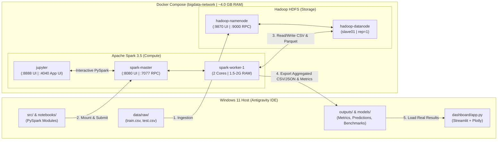

# Báo cáo Kiểm toán Repository & Đánh giá Môi trường (Repository Audit)

**Đề tài:** Large-Scale Bike Sharing Demand Analysis and Forecasting using Apache Spark  
**Tên tiếng Việt:** Phân tích dữ liệu quy mô lớn và dự đoán nhu cầu sử dụng xe đạp chia sẻ bằng Apache Spark  
**Repository gốc:** `https://github.com/trung10kg/distributed_sys_docker_setup.git`  
**Thư mục làm việc:** `c:\Users\BOOK PRO\distributed_sys_docker_setup`  
**Ngày kiểm toán:** 2026-11-10

---

## 1. Tổng quan Kiến trúc Repository Hiện tại

Repository hiện tại là một cụm Big Data tổng hợp chạy trên Docker Compose (`name: bigdata-cluster`, mạng nội bộ `bigdata-network`), được thiết kế theo mô hình multi-service trong một tệp `docker-compose.yml` duy nhất (18 services).

### 1.1. Danh mục các phiên bản công nghệ & Docker Images

| Thành phần | Docker Image | Phiên bản chính | Ghi chú kỹ thuật |
| :--- | :--- | :--- | :--- |
| **Hadoop HDFS & YARN** | `bde2020/hadoop-*` | Hadoop `3.2.1`, Java `8` | Mỗi daemon chạy trên 1 container riêng. Cấu hình qua `hadoop/hadoop.env`. |
| **Apache Spark** | `bitnamilegacy/spark:3.5` | Spark `3.5.0`, Scala `2.12`, Python `3.9` | Chạy chế độ Standalone (`spark-master` + 2 `spark-worker`). |
| **JupyterLab + PySpark** | `bigdata-cluster/jupyter-pyspark:3.5` | JupyterLab `4.2.5`, Pandas `2.2.2`, PyArrow `16.1.0` | Build trực tiếp trên `bitnamilegacy/spark:3.5`, đảm bảo khớp 100% Python `3.9` giữa Driver và Worker. |
| **Apache Flink** | `flink:1.18-scala_2.12` | Flink `1.18` | Stream processing (1 JobManager + 1 TaskManager). |
| **Apache Kafka** | `bitnamilegacy/kafka:3.7` | Kafka `3.7` (KRaft) | Không cần Zookeeper, đi kèm `provectuslabs/kafka-ui:v0.7.2`. |
| **Apache NiFi** | `apache/nifi:1.28.1` | NiFi `1.28.1` | Data ingestion kéo-thả, chạy HTTPS single-user. |
| **Apache Airflow** | `apache/airflow:2.9.3` | Airflow `2.9.3` | Orchestration (LocalExecutor), phụ thuộc vào `postgres`. |
| **MinIO** | `minio/minio:latest` | Latest | S3-compatible object storage + `minio/mc` init container. |
| **PostgreSQL** | `postgres:16-alpine` | PostgreSQL `16` | Database dùng chung và lưu metadata cho Airflow. |

### 1.2. Cấu hình lưu trữ & Volume hiện tại

- **Named Volumes (lưu trong WSL2 Docker Virtual Disk):**
  - Hadoop: `hadoop_namenode`, `hadoop_datanode`, `hadoop_datanode_2`, `hadoop_historyserver`
  - Khác: `postgres_data`, `minio_data`, `kafka_data`, `nifi_*` (6 volumes)
- **Bind Mounts (ánh xạ trực tiếp từ máy Host):**
  - `./compute/spark/jobs` $\rightarrow$ `/opt/spark-jobs` (trên `spark-master`, `spark-worker-1`, `spark-worker-2`, `jupyter`)
  - `./compute/jupyter/notebooks` $\rightarrow$ `/home/jovyan/work` (trên `jupyter`)
  - `./hadoop/hadoop.env` $\rightarrow$ Nạp biến môi trường cấu hình XML cho toàn bộ cụm Hadoop

---

## 2. Phân loại Thành phần: Tái sử dụng vs. Chưa cần sử dụng

Để bám sát mục tiêu đề tài **Bike Sharing Demand Analysis & Forecasting** và tối ưu hóa cho cấu hình máy tính cá nhân (16 GB RAM, Docker cấp ~7.6 GiB RAM), các dịch vụ trong repository được phân loại như sau:

### 2.1. Thành phần CẦN GIỮ LẠI và TÁI SỬ DỤNG (Core Services - 4 Containers)

1. **`hadoop-namenode` (HDFS Master):** Quản lý metadata và namespace của hệ thống file phân tán (`hdfs://hadoop-namenode:9000`).
2. **`hadoop-datanode` (HDFS Worker 1 - `slave01`):** Lưu trữ dữ liệu vật lý cho `/bike-sharing/raw`, `/processed`, `/features`, `/predictions`, `/benchmark`.
3. **`spark-master` (Spark Standalone Master):** Quản lý tài nguyên tính toán phân tán cho các tác vụ PySpark, Spark SQL và Spark MLlib (`spark://spark-master:7077`).
4. **`spark-worker-1` (Spark Standalone Worker 1):** Thực thi các Executor của Spark.
5. **`jupyter` (JupyterLab + PySpark):** Môi trường phát triển tương tác (Notebooks) và có thể kiêm nhiệm chạy ứng dụng hoặc submit job. *(Lưu ý: Có thể chạy thường trực hoặc chỉ bật khi cần chạy Notebook).*

### 2.2. Thành phần TÙY CHỌN (Chỉ bật khi thực nghiệm mở rộng nếu đủ RAM)

- **`hadoop-datanode-2` (`slave02`):** Dùng khi muốn kiểm chứng cơ chế nhân bản block (`dfs.replication=2`). Ở chế độ tiết kiệm RAM, chỉ cần 1 DataNode (`dfs.replication=1`).
- **`spark-worker-2`:** Dùng khi muốn benchmark khả năng mở rộng ngang (horizontal scaling) từ 1 Worker lên 2 Workers trong Module 6.
- **`hadoop-resourcemanager`, `hadoop-nodemanager`, `hadoop-historyserver` (YARN):** Trong repository này, Spark đang được cấu hình chạy ở chế độ **Spark Standalone** (`spark://spark-master:7077`), không bắt buộc phải đi qua YARN. Do đó, 3 container YARN có thể **tắt mặc định** để tiết kiệm ~1.2 GB RAM.

### 2.3. Thành phần KHÔNG SỬ DỤNG trong phạm vi đề tài (Không khởi chạy)

Các dịch vụ sau không nằm trong luồng xử lý mục tiêu và tuyệt đối **không bật** để tránh lãng phí RAM, CPU, ổ đĩa và xung đột cổng:
- `postgres` (Xung đột cổng `5432` với Langfuse)
- `minio`, `minio-init` (Xung đột cổng `9000` với Langfuse ClickHouse)
- `kafka`, `kafka-ui`
- `nifi` (Rất nặng, chiếm ~1–1.5 GB RAM và ~1.8 GB image)
- `flink-jobmanager`, `flink-taskmanager`
- `airflow-init`, `airflow-webserver`, `airflow-scheduler`

---

## 3. Kiểm tra Xung đột Cổng (Port Conflict Analysis)

Hiện tại trên máy Host đang có **6 containers của hệ thống Langfuse** hoạt động. Dưới đây là bảng đối chiếu cổng giữa Langfuse và `docker-compose.yml` của dự án:

| Cổng Host | Dịch vụ Langfuse đang chiếm | Dịch vụ trong `docker-compose.yml` | Mức độ xung đột & Giải pháp |
| :--- | :--- | :--- | :--- |
| `3000`, `3030` | `langfuse-web-1`, `langfuse-worker-1` | Không dùng | **An toàn** |
| `5432` | `langfuse-local-postgres-1` | `postgres` (`5432:5432`) | **Xung đột!** $\rightarrow$ Giải pháp: **Không bật** service `postgres`. |
| `6379` | `langfuse-local-redis-1` | Không dùng | **An toàn** |
| `8123` | `langfuse-local-clickhouse-1` | Không dùng | **An toàn** |
| `9000` | `langfuse-local-clickhouse-1` | `minio` (`9000:9000`) | **Xung đột!** $\rightarrow$ Giải pháp: **Không bật** service `minio`. *(Lưu ý: `hadoop-namenode` dùng cổng nội bộ `9000` nhưng đã được map ra host ở cổng `9820:9000` nên hoàn toàn không đụng cổng `9000` trên host).* |
| `9090`, `9091` | `langfuse-local-minio-1` | Không dùng | **An toàn** |
| `9870`, `9820` | *(Trống)* | `hadoop-namenode` | **An toàn** (HDFS Web UI & RPC) |
| `9864` | *(Trống)* | `hadoop-datanode` | **An toàn** (DataNode 1 Web UI) |
| `7077`, `8080` | *(Trống)* | `spark-master` | **An toàn** (Spark Master RPC & UI) |
| `8888`, `4040` | *(Trống)* | `jupyter` | **An toàn** (JupyterLab & Spark App UI) |
| `8501` | *(Trống)* | *(Dự kiến cho Streamlit)* | **An toàn** (Sẽ dùng cho Dashboard) |

**Kết luận về cổng:** Nếu chỉ khởi chạy các dịch vụ thuộc nhóm **HDFS + Spark + Jupyter**, hệ thống **hoàn toàn không xảy ra bất kỳ xung đột cổng nào** với cụm Langfuse đang chạy.

---

## 4. Đánh giá Giới hạn Tài nguyên (RAM, CPU & Ổ đĩa)

### 4.1. Phân tích Bộ nhớ RAM (Memory Budget)

Kết quả kiểm tra thực tế từ `docker info` và `docker stats`:
- **Tổng RAM cấp cho Docker Desktop (WSL2):** `7.597 GiB` (~7,780 MB), 8 vCPUs.
- **Mức tiêu thụ hiện tại của 6 containers Langfuse:**
  - `langfuse-web-1`: ~1,095 MiB
  - `langfuse-worker-1`: ~753 MiB
  - `clickhouse-1`: ~726 MiB
  - `minio-1` + `postgres-1` + `redis-1`: ~175 MiB
  - **Tổng RAM Langfuse đang dùng:** **~2.70 GiB**.
- **Dung lượng RAM còn trống trong Docker VM:** **~4.89 GiB**.

**Ước tính RAM cho cụm HDFS + Spark (cấu hình tối giản):**
- `hadoop-namenode`: ~450 – 600 MB
- `hadoop-datanode` (1 node): ~350 – 500 MB
- `spark-master`: ~300 – 450 MB
- `spark-worker-1`: Nếu để mặc định `SPARK_WORKER_MEMORY=2G`, khi chạy job tối đa sẽ chiếm ~2.2 GB (gồm overhead).
- `jupyter` (khi mở notebook chạy driver): ~600 – 900 MB.
- **Tổng cộng khi chạy tải nặng:** ~4.0 – 4.6 GB $\rightarrow$ **Vừa khít trần 4.89 GiB còn lại của Docker!**

> **Khuyến nghị điều chỉnh cấu hình để tránh lỗi OOM (Out-Of-Memory):**
> 1. Chỉ bật **1 DataNode** (`hadoop-datanode`) và **1 Spark Worker** (`spark-worker-1`).
> 2. Chỉnh `SPARK_WORKER_MEMORY` của `spark-worker-1` xuống `1536M` (1.5 GB) hoặc giữ `2G` nhưng giới hạn `spark.executor.memory=1g` và `spark.driver.memory=512m` trong `spark-defaults.conf`.
> 3. Khi chạy các tác vụ nặng bằng `spark-submit` (như huấn luyện MLlib hoặc Benchmark 100x), nên chạy qua CLI trên `spark-master` hoặc tắt các kernel notebook không dùng trên `jupyter` để giải phóng RAM của Driver.

### 4.2. Phát hiện Quan trọng về Dung lượng Ổ đĩa (Disk Space Alert!)

Kết quả kiểm tra phân vùng ổ đĩa bằng PowerShell (`Get-Volume` & `Get-PSDrive`):
- **Ổ C (`C:\`):** Tổng `441.46 GB` — **Chỉ còn trống `14.68 GB`**.
- **Ổ D (`D:\`):** Tổng dung lượng phân vùng chỉ là `3.05 GB` — **Chỉ còn trống `1.96 GB`**.
- **Docker Images hiện có:** Chưa có sẵn image `bde2020/hadoop-*` và `bitnamilegacy/spark:3.5` trong máy.

**Đánh giá rủi ro ổ đĩa:**
1. Bạn có đề cập ưu tiên lưu dữ liệu dự án và Docker trên ổ D, **nhưng thực tế ổ D trên máy chỉ là một phân vùng nhỏ 3.05 GB (còn trống 1.96 GB)** — không đủ để chứa Docker VHDX hay dữ liệu lớn.
2. Ổ C còn trống **14.68 GB**, đủ để pull các image tối thiểu phục vụ đề tài nếu chúng ta **chỉ pull đúng 3 images cần thiết**:
   - `bde2020/hadoop-namenode:2.0.0-hadoop3.2.1-java8` (~1.0 GB)
   - `bde2020/hadoop-datanode:2.0.0-hadoop3.2.1-java8` (dùng chung base layer với namenode, tốn thêm ~100–200 MB)
   - `bitnamilegacy/spark:3.5` (~1.3 – 1.5 GB)
   - Build `bigdata-cluster/jupyter-pyspark:3.5` (dùng chung base layer với `bitnamilegacy/spark:3.5`, tốn thêm ~300–400 MB cho các thư viện Python).
   - **Tổng dung lượng ổ đĩa tiêu tốn cho Docker images:** chỉ khoảng **~2.8 – 3.2 GB** (thay vì 20 GB nếu pull toàn bộ repo).
3. Dữ liệu Bike Sharing gốc (`train.csv` + `test.csv`) chỉ nặng **~1.1 MB**. Ngay cả khi nhân bản **100x** cho bài toán Benchmark (~1.08 triệu dòng), dung lượng file CSV chỉ khoảng **~65 MB** và Parquet chỉ khoảng **~15–20 MB**. Với `dfs.replication=1`, tổng dung lượng dữ liệu lưu trên HDFS và máy host chỉ dưới **300 MB**.

---

## 5. Những Cấu hình & Vấn đề Tương thích Cần Điều chỉnh

Trước khi bắt tay vào triển khai ở các Milestone tiếp theo, cần lưu ý 5 điểm kỹ thuật sau:

1. **Hệ số nhân bản HDFS (`dfs.replication`):**
   - Hiện tại trong `hadoop/hadoop.env` (dòng 28), `HDFS_CONF_dfs_replication=2`.
   - Vì chúng ta chỉ chạy **1 DataNode** (`hadoop-datanode`) để tiết kiệm RAM, nếu giữ `dfs.replication=2`, HDFS sẽ cảnh báo thiếu node nhân bản (under-replicated blocks) hoặc gặp lỗi khi append/recovery.
   - **Điều chỉnh cần thiết:** Đổi `HDFS_CONF_dfs_replication=1` trong `hadoop/hadoop.env`.
2. **Thư viện Python trong `compute/jupyter/Dockerfile`:**
   - Hiện tại `Dockerfile` đã cài: `jupyterlab==4.2.5`, `notebook==7.2.2`, `ipywidgets==8.1.5`, `pandas==2.2.2`, `pyarrow==16.1.0`, `matplotlib==3.9.2`.
   - **Thiếu sót cho đề tài:** Chưa có `plotly`, `scikit-learn`, `streamlit`, `numpy` (dù numpy đã đi kèm pandas nhưng nên khai báo rõ).
   - **Điều chỉnh cần thiết:** Bổ sung `plotly`, `scikit-learn`, `streamlit` vào `compute/jupyter/Dockerfile` (hoặc cài đặt trên môi trường Python local cho Streamlit Dashboard).
3. **Chia sẻ thư mục Source Code & Dữ liệu vào Container:**
   - Hiện tại `spark-master`, `spark-worker-1` và `jupyter` mới chỉ mount `./compute/spark/jobs:/opt/spark-jobs` và `./compute/jupyter/notebooks:/home/jovyan/work`.
   - Để giữ nguyên `docker-compose.yml` hạn chế chỉnh sửa tối đa, hoặc chúng ta thêm 1 dòng bind-mount `./:/workspace` (hoặc `./src:/opt/src` và `./data:/opt/data`) vào các container Spark/Jupyter, hoặc đặt các module thực thi liên kết qua thư mục được mount. (Chi tiết sẽ xin phép bạn trước khi sửa).
4. **Cơ chế Hostname của DataNode (`slave01`):**
   - Trong `docker-compose.yml`, `hadoop-datanode` có `hostname: slave01` và network alias `slave01`.
   - Các tác vụ chạy **bên trong mạng Docker** (`spark-master`, `spark-worker-1`, `jupyter`, hoặc `hdfs dfs -put` từ trong container) sẽ tự phân giải `slave01` thành IP nội bộ của DataNode hoàn toàn bình thường.
   - Tuy nhiên, nếu chạy script Python trực tiếp trên Windows Host gọi WebHDFS hoặc HDFS RPC ra cổng `9820`, máy Windows sẽ không biết `slave01` là gì nếu chưa thêm `127.0.0.1 slave01` vào file `hosts`. Do đó, **mọi tác vụ đọc/ghi HDFS và chạy PySpark nên được thực thi bên trong container (`spark-master` / `jupyter`)**, vừa tránh lỗi mạng vừa không phụ thuộc cài đặt Java/Winutils trên máy Windows.
5. **Chưa có file `.env`:**
   - Repository hiện mới có `.env.example`, chưa có `.env`. Ở Milestone tiếp theo, cần tạo `.env` từ `.env.example` bằng lệnh `Copy-Item .env.example .env`.

---

## 6. Kiến trúc Triển khai Tối ưu Đề xuất



### Luồng dữ liệu chi tiết:
1. **Data Ingestion:** Đọc `train.csv` và `test.csv` từ `data/raw/`, kiểm tra schema và đẩy lên HDFS tại `/bike-sharing/raw/`.
2. **Preprocessing & Feature Engineering (PySpark):** Đọc từ HDFS `/bike-sharing/raw/`, trích xuất đặc trưng thời gian (`hour`, `day`, `month`, `year`, `dayofweek`), loại bỏ biến gây rò rỉ dữ liệu (`casual`, `registered`), chia tập Train/Validation theo mốc thời gian (Time-based split), và lưu định dạng **Parquet** xuống `/bike-sharing/processed/` và `/bike-sharing/features/`.
3. **Spark SQL Analytics:** Truy vấn trực tiếp trên bảng Parquet từ HDFS, tổng hợp 7 nhóm chỉ số phân tích và xuất kết quả raทั้ง HDFS lẫn thư mục `outputs/analytics/` (để Streamlit đọc nhanh mà không cần giữ cụm Spark chạy liên tục).
4. **Spark MLlib Modeling:** Xây dựng `Pipeline` (`VectorAssembler` + Regressor) cho 3 mô hình: **Linear Regression**, **Decision Tree Regressor**, **Random Forest Regressor**. Đánh giá bằng `MAE`, `RMSE`, `R²`, `RMSLE`. Lưu model tốt nhất vào HDFS `/bike-sharing/models/` (và `models/`) cùng bảng kết quả thực nghiệm vào `outputs/evaluation/`.
5. **Big Data Benchmark:** Sinh dữ liệu mở rộng có kiểm soát (`1x`, `10x`, `50x`, `100x` — gắn nhãn `is_synthetic=True`), lưu trên HDFS `/bike-sharing/benchmark/`, đo đạc thực tế thời gian đọc/ghi CSV vs. Parquet, thời gian truy vấn Spark SQL, và ảnh hưởng của số lượng Partitions. Lưu log thực nghiệm vào `outputs/benchmark/`.
6. **Streamlit Dashboard:** Kết nối trực tiếp với kết quả thực tế tại `outputs/` và mô hình dự đoán để hiển thị 5 trang chức năng với biểu đồ tương tác Plotly.

---

## 7. Cấu trúc Thư mục Dự án Đề xuất

Để tích hợp hài hòa vào repository hiện tại mà **không phá vỡ cấu trúc gốc** của repo, cấu trúc thư mục sẽ được tổ chức như sau:

```text
distributed_sys_docker_setup/          # Thư mục gốc của repository hiện tại
│
├── docker-compose.yml                 # Giữ nguyên cấu hình gốc (có backup nếu chỉnh nhẹ)
├── docker-compose.bak.yml             # Bản sao lưu an toàn trước khi chỉnh sửa
├── hadoop/
│   └── hadoop.env                     # Chỉnh dfs.replication=1 để chạy 1 DataNode
├── compute/
│   ├── jupyter/
│   │   ├── Dockerfile                 # Bổ sung plotly, scikit-learn, streamlit
│   │   ├── spark-defaults.conf
│   │   └── notebooks/                 # Liên kết hoặc chứa các notebook thực nghiệm
│   └── spark/
│       └── jobs/                      # Mount vào /opt/spark-jobs trong container
│
├── data/                              # Dữ liệu trên máy host (giữ gọn nhẹ < 200MB)
│   ├── raw/                           # train.csv, test.csv, sampleSubmission.csv
│   ├── processed/                     # Bản sao Parquet mẫu (nếu cần kiểm tra nhanh)
│   └── expanded/                      # Metadata hoặc script sinh dữ liệu (dữ liệu lớn lưu trên HDFS)
│
├── notebooks/                         # 5 Jupyter Notebooks theo đúng yêu cầu đề tài
│   ├── 01_data_exploration.ipynb
│   ├── 02_data_preprocessing.ipynb
│   ├── 03_spark_sql_analysis.ipynb
│   ├── 04_model_training.ipynb
│   └── 05_benchmark.ipynb
│
├── src/                               # Source code Python/PySpark module hóa
│   ├── config.py                      # Quản lý đường dẫn HDFS, cấu hình Spark, danh sách cột
│   ├── ingestion/
│   │   └── upload_to_hdfs.py          # Module 1: Kiểm tra schema & upload lên HDFS
│   ├── preprocessing/
│   │   └── clean_data.py              # Module 3: Làm sạch, Feature Engineering, lưu Parquet
│   ├── analytics/
│   │   └── spark_sql_analysis.py      # Module 4: 7 truy vấn Spark SQL & xuất kết quả
│   ├── modeling/
│   │   ├── train.py                   # Module 5: Huấn luyện LR, DT, RF bằng Spark MLlib
│   │   ├── evaluate.py                # Module 5: Tính MAE, RMSE, R2, RMSLE
│   │   └── predict.py                 # Module 5: Dự đoán trên dữ liệu mới
│   └── benchmark/
│       ├── generate_data.py           # Module 6: Tạo dữ liệu 1x, 10x, 50x, 100x có kiểm soát
│       └── benchmark_spark.py         # Module 6: Đo thời gian CSV vs Parquet, Partitioning
│
├── dashboard/                         # Module 7: Giao diện Streamlit + Plotly
│   ├── app.py                         # Trang chính & điều hướng (Overview)
│   └── pages/
│       ├── 1_Data_Analytics.py
│       ├── 2_Demand_Prediction.py
│       ├── 3_Model_Comparison.py
│       └── 4_Big_Data_Benchmark.py
│
├── models/                            # Lưu trữ metadata/model phục vụ dự đoán nhanh
├── outputs/                           # Lưu kết quả thực tế từ pipeline (CSV/JSON) cho Dashboard
│   ├── analytics/
│   ├── evaluation/
│   ├── predictions/
│   └── benchmark/
├── reports/                           # Biểu đồ tĩnh / báo cáo xuất ra (nếu cần)
│
├── docs/                              # Tài liệu kỹ thuật của dự án
│   ├── REPOSITORY_AUDIT.md            # (Tài liệu này)
│   ├── SYSTEM_ARCHITECTURE.md
│   ├── DATA_DICTIONARY.md
│   └── EXPERIMENT_RESULTS.md
│
├── requirements.txt                   # Thư viện Python cho môi trường phát triển & Dashboard
├── .env.example
└── README.md
```

---

## 8. Kế hoạch Triển khai theo Milestone (Implementation Roadmap)

Dự án được chia thành **8 Milestones** tuần tự. Mỗi milestone chỉ bắt đầu khi milestone trước đó đã hoàn thành và được kiểm증.

### Milestone 1: Repository Audit & Environment Setup *(Hiện tại)*
- **Mục tiêu:** Kiểm tra toàn diện repo, đánh giá tài nguyên RAM/Disk, kiểm tra xung đột cổng với Langfuse, lập kế hoạch chi tiết.
- **Tệp tạo mới:** `docs/REPOSITORY_AUDIT.md`.
- **Tiêu chí hoàn thành:** Tài liệu Audit đầy đủ, rõ ràng; người dùng xác nhận phương án cấu hình trước khi tác động vào Docker.

### Milestone 2: Cấu hình Hạ tầng & Khởi chạy Hadoop HDFS
- **Mục tiêu:** Sao lưu cấu hình gốc, tinh chỉnh nhẹ cấu hình (`dfs.replication=1`, tạo `.env`), khởi chạy `hadoop-namenode` và `hadoop-datanode`, chuẩn bị bộ dữ liệu Bike Sharing và nạp lên HDFS.
- **Tệp cần tạo/chỉnh sửa:**
  - Sao lưu `docker-compose.yml` $\rightarrow$ `docker-compose.bak.yml`, `hadoop/hadoop.env` $\rightarrow$ `hadoop/hadoop.env.bak`.
  - Tạo `.env` từ `.env.example`.
  - Chỉnh `HDFS_CONF_dfs_replication=1` trong `hadoop/hadoop.env`.
  - Mount thư mục dự án vào container Spark/Jupyter trong `docker-compose.yml`.
  - Tạo `src/config.py` và `src/ingestion/upload_to_hdfs.py`.
- **Tiêu chí hoàn thành:**
  - `hadoop-namenode` và `hadoop-datanode` ở trạng thái `healthy`.
  - Tạo thành công cấu trúc thư mục `/bike-sharing/{raw,processed,features,predictions,benchmark}` trên HDFS.
  - Upload thành công `train.csv` và `test.csv` lên `/bike-sharing/raw/` và kiểm tra qua lệnh `hdfs dfs -ls`.

### Milestone 3: Khởi chạy Apache Spark & Kết nối HDFS
- **Mục tiêu:** Khởi chạy `spark-master`, `spark-worker-1` (và `jupyter`), kiểm tra kết nối PySpark $\leftrightarrow$ HDFS, đọc thử `train.csv` và `test.csv` từ HDFS, kiểm tra schema/số dòng/số cột.
- **Tệp cần tạo/chỉnh sửa:**
  - Cập nhật nhẹ `compute/jupyter/Dockerfile` (thêm `plotly`, `scikit-learn`) và `compute/jupyter/spark-defaults.conf` (tối ưu bộ nhớ).
  - Hoàn thiện kiểm tra đọc HDFS trong `src/ingestion/upload_to_hdfs.py`.
- **Tiêu chí hoàn thành:**
  - Spark Master UI (`http://localhost:8080`) hiển thị `Alive Workers: 1`.
  - Job PySpark đọc thành công `hdfs://hadoop-namenode:9000/bike-sharing/raw/train.csv` (10,886 dòng, 12 cột) và `test.csv` (6,493 dòng, 9 cột).

### Milestone 4: Khám phá Dữ liệu (EDA), Tiền xử lý & Spark SQL Analytics
- **Mục tiêu:** Phân tích khám phá dữ liệu, làm sạch và trích xuất đặc trưng bằng PySpark (đảm bảo không bị Data Leakage từ `casual` và `registered`), lưu định dạng Parquet trên HDFS, và chạy 7 truy vấn Spark SQL.
- **Tệp cần tạo/chỉnh sửa:**
  - `src/preprocessing/clean_data.py`
  - `src/analytics/spark_sql_analysis.py`
  - `notebooks/01_data_exploration.ipynb`
  - `notebooks/02_data_preprocessing.ipynb`
  - `notebooks/03_spark_sql_analysis.ipynb`
  - `docs/DATA_DICTIONARY.md`
- **Tiêu chí hoàn thành:**
  - Dữ liệu Parquet được lưu thành công tại `/bike-sharing/processed/` và `/bike-sharing/features/`.
  - Tập Train và Validation được tách hợp lý theo thời gian (ví dụ: ngày 1–15 hàng tháng làm Train, ngày 16–19 hàng tháng làm Validation).
  - Các kết quả phân tích Spark SQL được xuất ra `/bike-sharing/analytics/` và `outputs/analytics/*.csv`.

### Milestone 5: Huấn luyện & Đánh giá Mô hình với Spark MLlib
- **Mục tiêu:** Xây dựng Pipeline MLlib (`VectorAssembler` + Model) huấn luyện 3 thuật toán hồi quy: **Linear Regression**, **Decision Tree Regressor**, **Random Forest Regressor**; đánh giá trên tập Validation bằng `MAE`, `RMSE`, `R²`, `RMSLE`; lưu mô hình và tạo dự đoán.
- **Tệp cần tạo/chỉnh sửa:**
  - `src/modeling/train.py`
  - `src/modeling/evaluate.py`
  - `src/modeling/predict.py`
  - `notebooks/04_model_training.ipynb`
- **Tiêu chí hoàn thành:**
  - Huấn luyện thành công 3 mô hình trên Spark, lưu model tốt nhất lên HDFS và `models/`.
  - Xuất bảng so sánh thực nghiệm trung thực (`MAE`, `RMSE`, `R²`, `RMSLE`, thời gian huấn luyện) ra `outputs/evaluation/model_metrics.csv`.
  - Tạo dự đoán trên tập Validation và `test.csv`, lưu vào `/bike-sharing/predictions/` và `outputs/predictions/`.

### Milestone 6: Thực nghiệm Mở rộng Quy mô & Big Data Benchmark
- **Mục tiêu:** Chứng minh vai trò của Apache Spark thông qua việc sinh dữ liệu mở rộng có kiểm soát (`1x`, `10x`, `50x`, `100x` — gắn nhãn `is_synthetic`), đo đạc hiệu năng đọc/ghi CSV vs. Parquet, thực thi Spark SQL, và khảo sát ảnh hưởng của số lượng Partitions.
- **Tệp cần tạo/chỉnh sửa:**
  - `src/benchmark/generate_data.py`
  - `src/benchmark/benchmark_spark.py`
  - `notebooks/05_benchmark.ipynb`
- **Tiêu chí hoàn thành:**
  - Tạo và lưu trữ các mức dữ liệu trên HDFS `/bike-sharing/benchmark/`.
  - Thu thập số liệu thực tế về kích thước file (CSV vs. Parquet), thời gian đọc, thời gian xử lý/truy vấn, số lượng partitions, và phân tích rõ chi phí khởi tạo (startup overhead) của Spark trên dữ liệu nhỏ so với lợi thế trên dữ liệu lớn.
  - Lưu kết quả vào `outputs/benchmark/benchmark_results.csv`.

### Milestone 7: Xây dựng Giao diện Streamlit Dashboard
- **Mục tiêu:** Xây dựng ứng dụng web tương tác gồm 5 trang bằng Streamlit và Plotly, hiển thị toàn bộ kết quả phân tích, dự đoán nhu cầu thuê xe theo thời gian thực và biểu đồ benchmark.
- **Tệp cần tạo/chỉnh sửa:**
  - `dashboard/app.py`
  - `dashboard/pages/1_Data_Analytics.py`
  - `dashboard/pages/2_Demand_Prediction.py`
  - `dashboard/pages/3_Model_Comparison.py`
  - `dashboard/pages/4_Big_Data_Benchmark.py`
  - `requirements.txt`
- **Tiêu chí hoàn thành:**
  - Dashboard khởi chạy mượt mà, hiển thị 100% số liệu thực tế từ pipeline.
  - Form dự đoán hoạt động chính xác, cho phép người dùng tùy chỉnh thông số thời tiết/thời gian và nhận kết quả dự đoán tức thì.

### Milestone 8: Hoàn thiện Tài liệu & Báo cáo Tổng kết
- **Mục tiêu:** Tổng hợp kết quả thực nghiệm, hoàn thiện kiến trúc hệ thống và hướng dẫn vận hành từ A–Z.
- **Tệp cần tạo/chỉnh sửa:**
  - `docs/SYSTEM_ARCHITECTURE.md`
  - `docs/EXPERIMENT_RESULTS.md`
  - Cập nhật `README.md` (bổ sung hướng dẫn chạy dự án Bike Sharing).
- **Tiêu chí hoàn thành:** Bộ tài liệu hoàn chỉnh, sẵn sàng phục vụ báo cáo và bảo vệ đồ án/đề tài.

